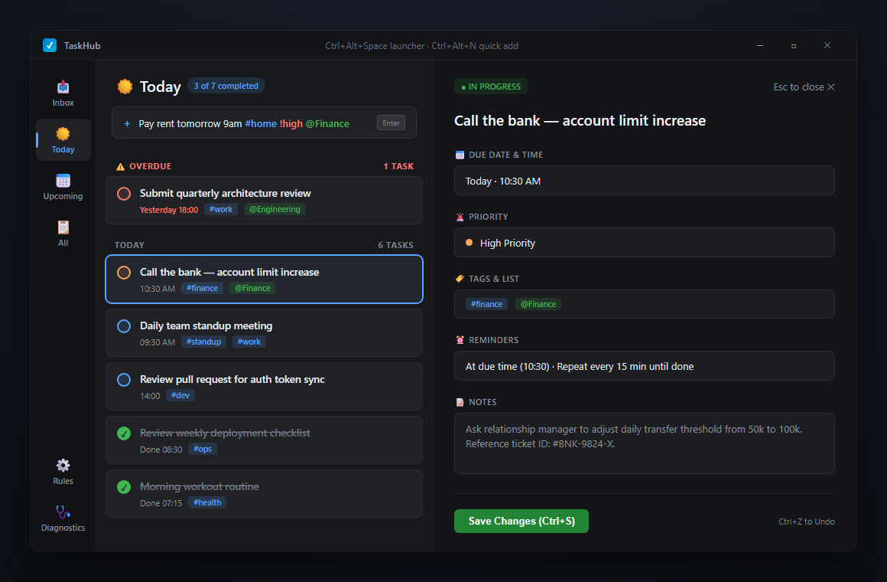

# ✅ TaskHub

<div align="center">

**A local-first to-do, reminder, and laptop automation hub for Windows.**
Built with .NET 10 and WPF. Everything runs on your machine — no account, no cloud, no subscription.

[](https://github.com/0-Name-Alex/TaskHub)
[](https://dotnet.microsoft.com/en-us/download/dotnet/10.0)
[](https://github.com/0-Name-Alex/TaskHub)
[](LICENSE)
[](https://modelcontextprotocol.io)
[](https://github.com/0-Name-Alex/TaskHub/releases/latest)
[](https://github.com/0-Name-Alex/TaskHub/releases/latest)

</div>

---

## 🤔 What is TaskHub?

TaskHub is a **personal productivity app** that lives quietly in your system tray and stays out of your way.
It handles tasks, reminders, automation rules, and smart notifications — and lets AI assistants like **Claude** control it via a built-in MCP server.

> 🔒 **100% local** — your data never leaves your PC. SQLite database, loopback API only.

### ✨ Key highlights

- 🗣️ **Natural-language quick-add** — type the way you think and press Enter
- 🔔 **Custom notifications** that never steal focus — a sleek island pill or acrylic banners
- ⚙️ **Rule engine** that reacts to reminders, files, battery, camera, idle, and more
- 🌐 **REST API + WebSocket** so any script or app can read and write your tasks
- 🤖 **AI integration** — Claude and other MCP clients can manage your tasks via `th mcp`
- 💾 **Local-first** — works offline, no account needed, no subscription

---

## 🖼️ Screenshot



---

## 🚀 Features at a Glance

| Feature | Details |
|---|---|
| ⚡ **Quick add** | Natural-language input — dates, times, tags, priorities, recurrence, lists |
| ⏰ **Reminders** | Per-task, recurring, snooze, nag-until-done, missed catch-up on wake |
| 🔔 **Custom notifications** | Island pill or frosted-glass banners; never steals focus; DND mode |
| ⚙️ **Automation rules** | React to events (reminders, files, battery, camera, system) with actions |
| 🔍 **Quick launcher** | `Ctrl+Alt+Space` — apps, tasks, rules, shortcuts, all fuzzy-matched |
| 📋 **Clipboard / screenshot** | One hotkey turns clipboard text or a screen region into a task |
| 💻 **CLI (`th`)** | Full command-line interface for scripts and power users |
| 🌐 **Local REST API** | Loopback HTTP — read/write tasks from any language or tool |
| 📡 **Live events** | WebSocket feed of everything happening in the app |
| 🤖 **AI integration** | `th mcp` — Claude Desktop and other MCP clients can manage your tasks |

---

## 🛠️ Requirements

- 🖥️ **Windows 10** (version 1809+) or **Windows 11**
- ⚙️ **.NET 10 SDK**

```powershell
winget install Microsoft.DotNet.SDK.10
```

---

## 🏁 Getting Started

### ⚡ Quick Install (No SDK required)

1. Download [**TaskHub-v1.0.0-win-x64.zip**](https://github.com/0-Name-Alex/TaskHub/releases/latest) from the latest release.
2. Extract the ZIP anywhere on your PC.
3. Double-click **TaskHub.exe** — the app immediately launches into your system tray!
*(Optional: keep `th.exe` in your PATH if you want to use the CLI or Claude MCP integration).*

---

### 🛠️ Build from Source (For developers)

### 1️⃣ Clone and build

```powershell
git clone https://github.com/0-Name-Alex/TaskHub.git
cd TaskHub
build.cmd          # builds + runs all tests; output in build-log.txt
```

### 2️⃣ Run (development mode)

```powershell
run-dev.cmd        # separate data folder in .devhome — safe to experiment
```

The app starts in the **system tray**. Click the tray icon to open the main window.

### 3️⃣ Build a self-contained release exe

```powershell
.\build.ps1 -Publish
# Output: artifacts\TaskHub\TaskHub.exe  and  artifacts\TaskHub\th.exe
```

---

## 📖 Using TaskHub

### 🪟 Main window

The sidebar shows your views — **Inbox, Today, Upcoming, Overdue, All, Completed, Trash** — plus your custom lists and tags. The quick-add box sits at the top; the task list fills the middle; click any task to open the editor on the right (`Esc` closes and saves).

Tasks are grouped by date: **Overdue → Today → Tomorrow → Next 7 days → Later → No date**.
The coloured circle shows priority (🔵 medium, 🟠 high, 🔴 urgent).
Hover a row for quick *move to tomorrow* and *delete* buttons.

---

### ⚡ Quick add

Type naturally and press **Enter**:

```
Pay rent tomorrow 9am #home !high @Finance
Call mom friday evening
Dentist 20 nov 3:30pm !urgent
Standup every weekday 9:30am
Water plants every 3 days
"Monday" meeting notes        ← quotes keep words literal
```

| Syntax | Meaning |
|---|---|
| `#tag` | 🏷️ Add a tag |
| `@List` / `@Two_Words` | 📂 Assign to a list (created if it doesn't exist) |
| `!low` `!med` `!high` `!urgent` — or `!1`–`!4`, `!!`, `!!!` | 🚨 Priority |
| `today` `tonight` `tomorrow` `mon`–`sun` `next fri` `in 3 days` `20 nov` | 📅 Due date |
| `9am` `9:30pm` `21:00` `noon` `morning` `afternoon` `evening` `in 2 hours` | 🕐 Due time |
| `daily` `weekdays` `weekly` `every monday` `every 2 weeks` | 🔁 Recurrence |

> 💡 Adding a task while a **list**, **tag**, or **Today** is selected automatically places it there.

---

### ⏰ Reminders

Tasks with a due time remind you at that time by default. Tasks with only a date remind at **09:00**.

In the editor you can set:
- **Remind me** — at due time, 15 min before, 1 hour before, 1 day before, or a custom offset
- **Until done, remind every N minutes** — keeps nudging until the task is completed
- **Repeat** — friendly text (`every monday`) or an iCalendar RRULE

> 😴 Reminders missed while your laptop was asleep or TaskHub was closed are caught up on wake.
> More than 3 missed reminders are grouped into one banner.

Banner buttons: ✅ **Done** · 💤 **Snooze** (10 min, configurable) · 📂 **Open**

---

### 🔔 Notifications

TaskHub draws its own notifications — they appear on the monitor your mouse is on and **never steal keyboard focus**.

| Style | Description |
|---|---|
| 🏝️ **`island`** *(default)* | A black pill at the top of the screen. Notifications grow in and shrink away. One at a time; extras show as **+2**. Pauses during full-screen apps/games (urgent ones don't). |
| 🗂️ **`banner`** | Frosted-glass cards that slide down and stack (up to 3). Hover to pause; click or drag up to dismiss. |

Both styles follow Windows **light/dark theme** and **accent colour** automatically. A soft chime plays (can be turned off).

**🚫 Do Not Disturb** — available from the tray menu, the Notifications tab, or a hotkey. Holds all banners until DND ends, then groups them.

**📷 Camera & microphone indicator** — when an app starts using your camera or mic, the island briefly shows *"Zoom is using your camera"* 🟢 or *"…microphone"* 🟠. Rules can react too: `camera.started`, `microphone.started`, etc.

---

### ⌨️ Keyboard shortcuts

| Shortcut | Action |
|---|---|
| `Ctrl+N` | ⚡ Quick add |
| `Ctrl+F` | 🔍 Search |
| `Ctrl+Z` | ↩️ Undo |
| `Ctrl+S` | 💾 Save editor |
| `Space` | ✅ Complete selected task |
| `Delete` | 🗑️ Move to trash |
| `Esc` | ← Close editor / clear search |
| `Ctrl+Alt+T` | 🪟 Show / hide TaskHub |
| `Ctrl+Alt+N` | ⚡ Quick add from anywhere |
| `Ctrl+Alt+Space` | 🔍 Quick launcher |
| `Ctrl+Alt+V` | 📋 Clipboard → task |
| `Ctrl+Alt+S` | 📸 Screenshot region → task |

> ⚙️ All global hotkeys are configurable in `config.toml` under `[hotkeys]`.

---

### 🔍 Quick launcher (`Ctrl+Alt+Space`)

Type to find Start Menu apps, your open tasks, automation rules, shortcuts, and built-in commands (screenshot, clipboard, DND, today's view, config file…). `Enter` runs the top match; a task opens in the main window; `Ctrl+Enter` completes it. Frequently used items move up automatically.

---

### 📋 Capture (clipboard & screenshot)

- **`Ctrl+Alt+V`** — clipboard → task. Text becomes the title + notes; an image is saved and attached; copied files are attached in place.
- **`Ctrl+Alt+S`** — freeze screen, drag a rectangle → becomes a task with the screenshot attached. A banner confirms with an **Open** button.

> ⚙️ Set `capture_list` in `[automation]` to send all captures to a specific list.

---

## ⚙️ Automation

Rules live in `config.toml`. Saving the file applies them immediately. The **Automation** tab shows each rule with its last run time, any errors, and a **Run now** button.

```toml
# 📅 Open a meeting link when a "standup" reminder fires
[[rules]]
name = "Stand-up link"
when = "reminder.due"
if   = "task.tags contains 'standup'"
then = ["open https://meet.example.com/standup", "dnd on"]

# 📂 Auto-task PDF invoices dropped in Downloads
[[rules]]
name = "Invoices"
when = "file.detected"
if   = "watch == 'downloads' and extension == '.pdf' and name contains 'invoice'"
then = ["add Pay {name} tomorrow #finance", "notify New invoice | {name}"]
cooldown = 10

# 🎯 Hotkey-triggered focus mode
[[rules]]
name  = "Focus"
hotkey = "Ctrl+Alt+F"
then  = ["dnd toggle", { action = "run", shell = "pwsh", script = "C:\\scripts\\focus.ps1" }]

# 🔋 Battery warning
[[rules]]
name = "Low battery"
when = "system.battery.low"
then = ["notify Battery at {percent}% | Plug in soon"]

# 👁️ File watcher used by the invoice rule above
[[watch]]
name   = "downloads"
path   = "~/Downloads"
filter = ["*.pdf", "*.docx"]
```

### 🎬 Available actions

| Action | What it does |
|---|---|
| `open <url/file/app>` | 🌐 Opens it like a double-click |
| `run <program> [args]` | ▶️ Starts a program (never through a shell) |
| `notify <title> [| body]` | 🔔 Shows a TaskHub banner |
| `add <quick-add text>` | ✅ Creates a task |
| `done` / `snooze [min]` | ✅ / 💤 Completes or snoozes the related task |
| `dnd on/off/toggle` | 🚫 Do Not Disturb |
| `copy <text>` | 📋 Puts text on the clipboard |
| `screenshot` / `clip` | 📸 Same as the capture hotkeys |
| `wait <seconds>` | ⏳ Pause (max 300 s) |
| `log <text>` | 📝 Write to the app log |

> 💡 `{placeholders}` are filled from the event: `{task.title}`, `{path}`, `{percent}`, `{now}`, `{today}`, `{weekday}`, etc.

### 📡 Events rules can listen to

| Event | Fields |
|---|---|
| `reminder.due` | `task.*`, `missed` |
| `task.created` / `updated` / `completed` / `deleted` | `task.*` |
| `file.detected` | `watch`, `path`, `name`, `extension`, `size` |
| `system.idle` / `system.active` | `idleMinutes` |
| `system.battery.low` / `system.power.ac` / `system.power.battery` | `percent`, `onBattery` |
| `system.locked` / `unlocked` / `resumed` / `suspended` | — |
| `camera.started` / `stopped` / `microphone.started` / `stopped` | `app`, `appId`, `device` |

---

## 💻 Command-line Interface (`th`)

`th.exe` talks to the running TaskHub app over its local API.

```powershell
# ➕ Add tasks
th add "Pay rent tomorrow 9am #home !high @Finance"
th add "Standup 9:30am" --repeat "every weekday" --remind 0,10 --on-remind "open https://meet.example.com"

# 📋 List tasks
th ls                              # all open tasks
th ls -v today                     # today's view
th ls -t home -l Finance -s rent   # filter by tag, list, search
th ls --json                       # JSON output

# ✅ Manage tasks
th done 3f2a91c0
th edit 3f2a91c0 --due 2026-11-20 --time none -p urgent
th snooze 3f2a91c0 30
th rm 3f2a91c0
th restore 3f2a91c0
th undo

# 📂 Lists & tags
th lists
th lists add "Side Project"
th tags

# 💾 Import / export
th export backup.json
th import backup.json

# 🔔 Notifications & DND
th notify "Backup done" --body "42 GB" -p high
th dnd on

# 🤖 AI (MCP server)
th mcp
th mcp --read-only
```

> ⚠️ **PowerShell tip:** quote quick-add text — `#` starts a comment and `@` means splatting in unquoted PowerShell.

---

## 🤖 AI Integration — MCP Server

`th mcp` is a [Model Context Protocol](https://modelcontextprotocol.io) server over `stdio`.
AI assistants that support MCP (such as **Claude Desktop**) can read and manage your real tasks:

> 💬 *"What's due today?"*
> 💬 *"Remind me to call the bank this Friday at 10am."*
> 💬 *"I finished the report — and move the dentist to next week."*

Everything still goes through the running TaskHub app, with full **undo**, **event bus**, and **notifications**.

### 🔌 Connect Claude Desktop

Open **Settings → Developer → Edit Config** and add TaskHub to `claude_desktop_config.json`:

```json
{
  "mcpServers": {
    "taskhub": {
      "command": "C:\\path\\to\\artifacts\\TaskHub\\th.exe",
      "args": ["mcp"]
    }
  }
}
```

Then restart Claude Desktop. TaskHub must be running in the tray.

> 🔒 Add `"--read-only"` to `args` if you want the assistant to look but not change anything.

### 🛠️ Available tools

| Tool | Does |
|---|---|
| `get_status` | 🕐 Today's date, local time, time zone |
| `list_tasks` | 📋 List tasks by view with search and filters |
| `get_task` | 🔍 Full details of one task |
| `list_lists` / `list_tags` | 📂 Your lists and tags |
| `add_task` | ➕ Add a task with natural-language text |
| `update_task` | ✏️ Change any field |
| `complete_task` / `reopen_task` / `delete_task` / `snooze_task` / `undo` | ✅ Actions |
| `notify` | 🔔 Show a banner on your screen |
| `set_do_not_disturb` | 🚫 Toggle Do Not Disturb |

---

## 🌐 Local API (for scripts and other apps)

TaskHub exposes a local HTTP API on `127.0.0.1` (loopback only). Every request requires `Authorization: Bearer <token>`.

**🔍 Discovery** — while TaskHub is running, read `%LOCALAPPDATA%\TaskHub\api.json`:

```json
{ "port": 47821, "tokenFile": "C:\\Users\\you\\AppData\\Local\\TaskHub\\api.token" }
```

| Method | Path | Description |
|---|---|---|
| `GET` | `/v1/status` | Version, process ID, time zone |
| `GET` | `/v1/tasks` | List tasks — `?view=today&q=&tag=&list=` |
| `POST` | `/v1/tasks` | Create a task |
| `PATCH` | `/v1/tasks/{id}` | Update fields (`null` clears) |
| `POST` | `/v1/tasks/{id}/complete` | ✅ Complete |
| `POST` | `/v1/tasks/{id}/snooze` | 💤 Snooze |
| `DELETE` | `/v1/tasks/{id}` | 🗑️ Move to trash |
| `POST` | `/v1/undo` | ↩️ Undo last action |
| `GET/POST` | `/v1/lists` | List or create lists |
| `GET/POST` | `/v1/export` / `/v1/import` | 💾 JSON export/import |
| `POST` | `/v1/notifications` | 🔔 Show a banner |
| `GET/PUT` | `/v1/notifications/dnd` | 🚫 Do Not Disturb state |

**PowerShell example:**

```powershell
$d = Get-Content "$env:LOCALAPPDATA\TaskHub\api.json" | ConvertFrom-Json
$h = @{ Authorization = "Bearer $(Get-Content $d.tokenFile)" }

# Get today's tasks
Invoke-RestMethod "http://127.0.0.1:$($d.port)/v1/tasks?view=today" -Headers $h

# Add a task
Invoke-RestMethod "http://127.0.0.1:$($d.port)/v1/tasks" -Method Post -Headers $h `
  -ContentType 'application/json' -Body '{"text":"Buy milk tomorrow #errands"}'
```

---

## 📡 Live Events (WebSocket)

Watch TaskHub in real time:

```
ws://127.0.0.1:<port>/v1/events?topics=task.*,reminder.due
Authorization: Bearer <token>
```

Each message is a JSON event:

```json
{
  "id": "0192…",
  "type": "task.created",
  "time": "2026-11-03T05:30:00Z",
  "source": "ui",
  "data": { "task": { … } }
}
```

> Ready-made examples: [`samples/events.py`](samples/events.py) and [`samples/events.ps1`](samples/events.ps1).

---

## 📁 Data & Files

| What | Location |
|---|---|
| ⚙️ Config file (hot-reloaded on save) | `%APPDATA%\TaskHub\config.toml` |
| 🗄️ Database (SQLite + WAL) | `%LOCALAPPDATA%\TaskHub\data\taskhub.db` |
| 💾 Daily backups *(14 kept)* | `%LOCALAPPDATA%\TaskHub\backups\` |
| 📝 Logs | `%LOCALAPPDATA%\TaskHub\logs\` |
| 🔑 API discovery + token | `%LOCALAPPDATA%\TaskHub\api.json` |
| 📸 Screenshots / clipboard attachments | `%LOCALAPPDATA%\TaskHub\attachments\YYYY-MM\` |

> 💡 Set `TASKHUB_HOME=D:\somewhere` to run a fully separate instance with its own config, database, and autostart entry. `run-dev.cmd` uses `.devhome` for this.

---

## 🏗️ Project Structure

```
TaskHub/
├── 📁 src/
│   ├── TaskHub.Abstractions/      # Public SDK — contracts, event types, DTOs
│   ├── TaskHub.Core/              # Domain, services, scheduler, rule engine
│   ├── TaskHub.Storage/           # EF Core + SQLite, migrations
│   ├── TaskHub.Api/               # Kestrel REST API + WebSocket
│   ├── TaskHub.Platform.Windows/  # Hotkeys, power events, camera, autostart
│   ├── TaskHub.Notifications/     # Custom island + banner windows
│   ├── TaskHub.Automation/        # Clipboard, screenshot, launcher, file watcher
│   ├── TaskHub.App/               # WPF app — entry point, UI, ViewModels
│   └── TaskHub.Cli/               # `th` CLI + `th mcp` AI server
└── 📁 tests/
    ├── TaskHub.Core.Tests/
    ├── TaskHub.Storage.Tests/
    └── TaskHub.Api.Tests/
```

---

## 📊 Build Status

| Phase | Description | Status |
|---|---|---|
| 0 | 🏗️ App shell — host, single instance, tray, config, logging, event bus, autostart, hotkeys | ✅ Done |
| 1 | 💾 Core + storage — tasks, SQLite, undo, search, import/export, CLI, task UI | ✅ Done |
| 2 | ⏰ Reminders, recurrence, snooze, missed catch-up, daily backup | ✅ Done |
| 3 | 🔔 Custom notification banners — acrylic, animations, stacking, DND, history | ✅ Done |
| 4 | ⚙️ Automation — rules, actions, clipboard/screenshot capture, launcher, file watcher | ✅ Done |
| 5 | 🤖 Live events over WebSocket, MCP server for AI assistants (`th mcp`) | ✅ Done |
| 6 | 🚀 Phone reminders, calendar, local AI, voice, plugins | 🗓️ Future |

---

## 🗓️ Future Updates

The core app is complete. These features are planned for upcoming releases:

| Feature | Description |
|---|---|
| 🤖 **Local AI (Ollama)** | On-device LLM — natural-language task management, fully offline |
| 🎙️ **Voice input (Whisper)** | Speak to add tasks — local speech-to-text using OpenAI Whisper |
| 📱 **Phone reminders (Telegram / ntfy)** | Push reminders to your phone even when the laptop is closed |
| 📅 **Calendar integration** | Two-way sync with Google Calendar / iCal |
| 🧩 **Plugin system** | Extend with .NET plugins or scripts in any language |
| 👋 **Greeter app** | A companion window on sign-in and resume — today's tasks, quick-add, next reminder |

---

## 📄 License

This project is open source. See [LICENSE](LICENSE) for details.

---

<div align="center">

Made with ❤️ for Windows · Built on .NET 10 · Runs 100% local

⭐ **Star this repo if you find it useful!**

</div>
